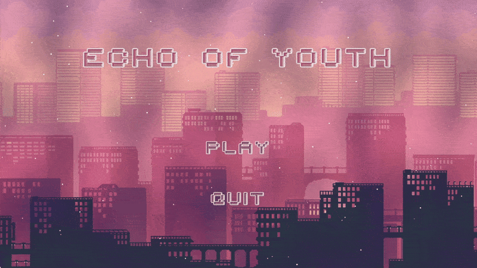
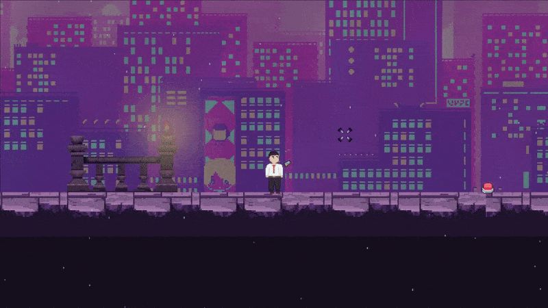
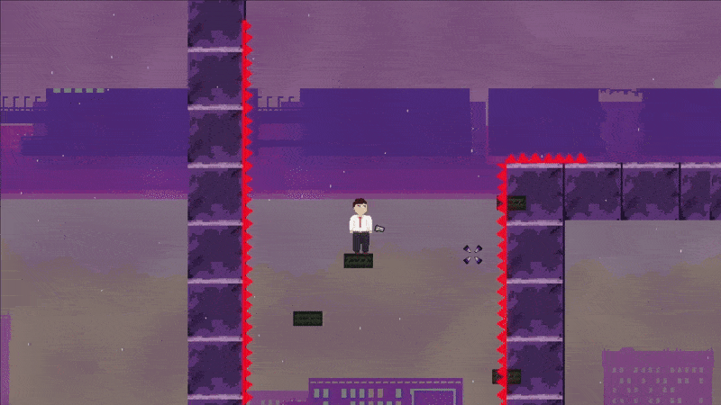

# Echo-of-Youth

  

  
  

## About

A 2D puzzle-platformer made in Unity for The Great Warwick Game Jam 2025. Move objects with the reverse gun and rewind their paths to navigate the levels.

[Play Echo of Youth](https://vec1or2000.itch.io/echo-of-youth)

## Run locally

Clone this repository and add the folder in Unity Hub. Open with **Unity 6 (6000.0.32f1)**, let the assets import, then open `Assets/Scenes/Main Menu.unity` and press **Play**.

## Controls

| Action | Control |
| --- | --- |
| Move | A / D or Left / Right arrow |
| Jump | Space |
| Aim | Mouse |
| Grab and move an object | Hold left mouse button |
| Rewind an object | E or right mouse button |

Pick up the reverse gun to unlock object interaction.

## Team

- [Tongyu Wu/Jimmy](https://github.com/NoSameRain)
- Lidiia Tonieva
- [Savva Gorelik](https://github.com/Nosohvost)
- [Michael Rothery](https://github.com/michael-rothery-warwick)
- [Rohit Karavadra](https://github.com/RohitKaravadra)
